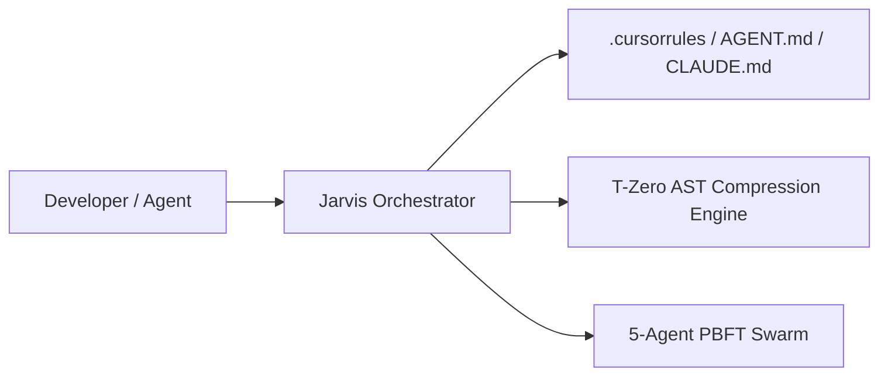

# 🌐 T-ZERO JARVIS MASTER WORKSPACE ORCHESTRATION REPORT
*Executive Workspace Manager: Toprak Ahmet Aydoğmuş (Siber Akademi)*
*Generated on: 2026-10-22 08:27:17 | Orchestration Duration: 49.92 ms*

---

## 1. Executive Summary
- **Workspace Name:** `TZeroAlgorithm`
- **Primary Language:** **Python**
- **Architecture Pattern:** **Autonomous CLI / Tool Architecture**
- **5-Agent Swarm PBFT Consensus:** **✅ APPROVED**
- **Total Incurred Cost:** `$0.00` (100% Free / Zero Cloud API Key Required)

## 2. Workspace Profile & Telemetry
- **Detected Frameworks:** `Standard Library`
- **Package Managers:** `poetry/uv/flit, pip`
- **Total Tracked Files:** `447`
- **Estimated Code Lines:** `~29336`
- **T-Zero Token Optimization:**
  - Raw Context Volume: `8,761,140 tokens`
  - T-Zero Compressed AST Context: `1,051,336 tokens`
  - **Net Context Budget Savings: 88.0%**

## 3. Active AI Governance & Rule Files Generated
The following specialized `.md` and configuration governance contracts are active in this workspace:
- `.cursorrules`
- `AGENT.md`
- `AGENTS.md`
- `.clinerules`
- `.windsurfrules`
- `CLAUDE.md`
- `.github/copilot-instructions.md`
- `ARCHITECTURE.md`
- `tzero.rules.json`
- `.cursor/rules/architecture.mdc`
- `.cursor/rules/security.mdc`
- `.cursor/rules/testing.mdc`

## 4. 100% Zero-Leak Security Audit
- 🛡️ No hardcoded credentials or leak vulnerabilities detected.

## 5. Architectural Boundaries & Standards

*T-Zero Jarvis Master Orchestrator guarantees zero regressions, minimal blast radius, and 100% boundary fidelity.*
